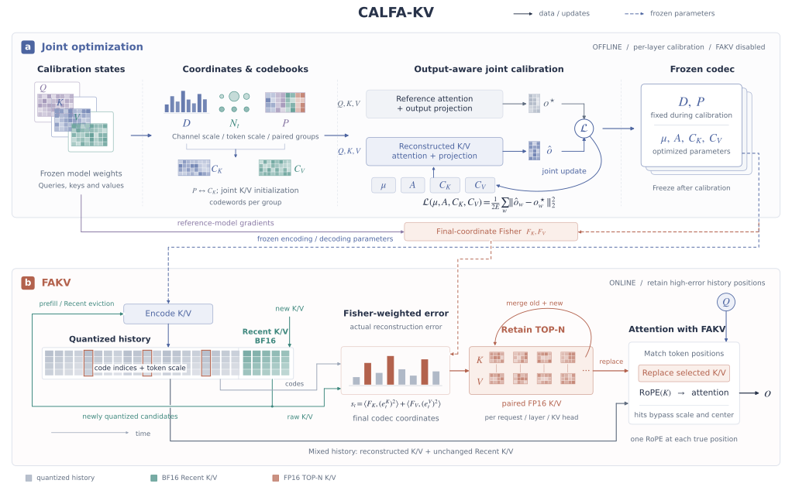

# CALFA-KV

CALFA-KV combines **offline joint optimization** and **online FAKV** for low-bit KV caches. It first learns coordinates and codebooks suited to compression, then retains high-precision K/V for the small set of historical positions that remain sensitive to quantization. Both components use the same frozen assets, position definitions, and encoding rules.



**Figure 1. CALFA-KV overview.** (a) Joint optimization constructs channel scaling D, token magnitude Nₜ, grouping P, and the initial codebooks from calibration states captured from the frozen model. After selecting the grouping, it fixes D/P and jointly updates the center μ, radial parameters A, and K/V codebooks using the post-projection attention output error. Here w denotes a calibration window, o★/ô denote the reference and quantized outputs, and E is the total reference output energy. (b) FAKV uses reference-model gradients to calibrate Fisher weights separately in the final coordinates defined by the frozen parameters. At runtime, it scores candidates using actual reconstruction error, merges them with previously retained positions, stores paired FP16 K/V for the TOP-N positions, and substitutes them for the corresponding reconstructed rows in attention. Recent K/V follow the existing high-precision path. The TOP-N retention budget and token magnitude Nₜ are defined separately, with configuration values given below. Solid lines show data flow or joint updates. Dashed lines show frozen parameters and Fisher weights. Gradients do not propagate between the two components. Tensors, error bars, and retained positions are schematic.

[Vector SVG](docs/calfa_kv_pipeline.svg) · [300 dpi PNG](docs/calfa_kv_pipeline.png) · [Vector PDF](docs/calfa_kv_pipeline.pdf) · [Figure source](docs/draw_pipeline.py) · [Joint optimization](joint_optimization/README.md) · [FAKV](fakv/README.md) · [End-to-end workflow](pipeline/README.md)

## Core components and end-to-end workflow

| Component | Purpose | Code |
|---|---|---|
| 1. Joint optimization | Prepare channel scaling, shared magnitudes, and grouping, then jointly learn the center, radial parameters, and K/V codebooks | [joint_optimization/](joint_optimization/) |
| 2. FAKV | Calibrate importance in the final coordinates, retain high-error positions from candidates entering quantized history, and replace the corresponding K/V in attention | [fakv/](fakv/) |
| End-to-end workflow | Verify asset identities and connect the joint optimization outputs, Anchor calibration, and cache lifecycle in one inference workflow | [pipeline/](pipeline/) |

`assets/optimized/` ships a frozen set of assets from joint optimization. `joint_optimization/coordinates/initialization/` ships the corresponding initialization assets. See [SOURCES.md](SOURCES.md) and [LICENSE](LICENSE) for code provenance and licensing.

## Current configuration

| Item | Configuration |
|---|---|
| Model | Qwen3-4B-Instruct-2507, revision `cdbee75f17c01a7cc42f958dc650907174af0554` |
| Architecture | 36 layers, 32 query heads, 8 KV heads, head dimension 128 |
| Quantization | K and V use 8-dimensional groups with 256 FP16 codewords per group. Each group index uses 8 bits, for an index payload of 1 bit per channel |
| High-precision cache | Prefix=0, Recent=64 (BF16), and up to 56 Anchors per request, layer, and KV head (paired FP16 K/V) |
| Magnitude | One FP16 K scale per token and layer shared across all 8 KV heads. V uses unit scale |
| Positional encoding | RoPE theta=5,000,000. The codec encodes K before RoPE, and attention applies the rotation for the actual position |
| Calibration | 64 fixed windows. Joint calibration uses template-wrapped 2056-token inputs, with FIT48 for updates and validation16 for checking candidate regressions |
| Optimization | Joint calibration runs independently per layer, with up to 8 rounds per layer, up to 24 CG iterations, and 12 halving backtracking levels |
| Inference | TP1, Triton prefill/decode, and a context length of 32768. Page-8 migration and decode CUDA Graph are enabled. Piecewise Graph, radix cache, and chunked prefill are disabled |

## Part 1. Joint optimization

### Joint construction of encoding coordinates, groups, and codebooks

For each layer, this stage constructs channel scaling, determines the magnitude representation used in storage, selects groups together with their codebooks, and jointly calibrates the initial K/V codebooks. **Joint construction means fitting, comparing, and retaining each grouping with its corresponding codebook, then updating K/V under a shared output objective. The operations follow the dependency order below.** D is computed from statistics and then fixed. The discrete search updates P, which is fixed for the subsequent continuous joint calibration.

We omit the layer index below. The window index is b, the key and query positions within a window are t and s, respectively, the KV head index is h, and the channel index is j. K is captured after `k_norm` and before RoPE, the query after `q_norm`, and V at the output of `v_proj`.

| Symbol | Definition and dimensions in this configuration |
|---|---|
| $k_{b,t,h},v_{b,t,h}$ | K/V for one KV head, each with 128 dimensions. Concatenating all H=8 heads gives 1024 dimensions |
| $\mathcal A_h$, $R_t$ | The 4 query heads associated with KV head h and the RoPE matrix at position t |
| $D=\mathrm{diag}(w)$, $P$ | Positive diagonal channel scaling and a block permutation matrix organized by head, both acting on 1024-dimensional K |
| $\xi_{b,t}$, $z_{b,t}=P\xi_{b,t}$ | Normalized K before and after permutation. Each head is divided into G=16 groups of 8 dimensions |
| $C^K_{h,g},C^V_{h,g}$ | Each group has B=256 codewords per side, each with 8 dimensions and stored in FP16 |

#### 1. Derive channel scaling D from causal query energy

Let $\bar q_{b,s,a}=R_s q_{b,s,a}$ denote the post-RoPE query and $e_{b,t,h}=\hat k_{b,t,h}-k_{b,t,h}$ the K reconstruction error. In real arithmetic, the logit error for a visible position t≤s satisfies the following relation.

```math
\Delta\ell_{b,s,t,a}
=\frac{\bar q_{b,s,a}^{\top}R_t e_{b,t,h}}{\sqrt{128}},
\qquad a\in\mathcal A_h.
```

Let $`\mathcal T=\{(b,s,t):0\le t\le s<T_b\}`$, where $T_b$ is the window length. Take the mean over all valid causal position pairs and their associated query heads.

```math
M_h=\frac{1}{4|\mathcal T|}
\sum_{(b,s,t)\in\mathcal T}\sum_{a\in\mathcal A_h}
R_t^{\top}\bar q_{b,s,a}\bar q_{b,s,a}^{\top}R_t,
\qquad m_{h,j}=(M_h)_{jj}.
```

Earlier keys occur in more causal position pairs. The implementation computes the diagonal entries above using suffix sums of query second moments, without explicitly storing the full matrix at each position. The diagonal energy approximation yields the following positive channel multipliers.

```math
\epsilon_h=\max\!\left(10^{-30},10^{-6}\max_j m_{h,j}\right),\quad
b_{h,j}=\max(m_{h,j},\epsilon_h),\quad
w_{h,j}=\sqrt{\frac{b_{h,j}}{128^{-1}\sum_i b_{h,i}}}.
```

Thus, every head satisfies $128^{-1}\sum_j w_{h,j}^2=1$. D scales up directions with higher query energy before quantization, and reconstruction applies the inverse scaling. This scaling uses a diagonal approximation to query energy. Minimizing the full attention output error is a separate objective. The resulting w is rounded to FP32 and frozen. See [prepare_coordinates.py](joint_optimization/tools/prepare_coordinates.py).

#### 2. Define encoding coordinates using the stored FP16 magnitude

At this stage, the center is zero and the radial weights are D. First compute $x=\mathrm{FP32}(k)\odot w$ in the original head-major order, then compute one magnitude shared across all 8 KV heads. To fix the reduction order used in practice, flatten x into 1024 channels and denote FP32 rounding by $\mathrm{fl}_{32}$.

```math
a_i^{(0)}=\mathrm{fl}_{32}(x_i^2),\qquad
 a_i^{(u+1)}=\mathrm{fl}_{32}
 \!\left(a_{2i}^{(u)}+a_{2i+1}^{(u)}\right),
\quad u=0,\ldots,9.
```

Each multiplication, addition, division, and square root follows the implementation's FP32 arithmetic. The resulting magnitude is then stored in FP16.

```math
N_{b,t}=\mathrm{FP16}\!\left[
\max\!\left(10^{-4},\sqrt{a_0^{(10)}/1024}\right)\right],\qquad
\xi_{b,t}=\frac{x_{b,t}}{\mathrm{FP32}(N_{b,t})},\qquad
z_{b,t}=P\xi_{b,t}.
```

P is applied **after** computing N. The addition tree is independent of `head_order` and the group permutation. Statistics, fitting, native encoding, and cache migration all use the same stored N, including its rounding. V uses unit scale and stays in its original coordinates for this step. See [calfa_scale.py](backend/python/calfa_scale.py).

#### 3. Build an initial grouping from normalized covariance under RoPE constraints

For each head, use the unpermuted $\xi_{b,t,h}$ and accumulate its mean and second moment over all n calibration tokens in FP64.

```math
\bar\xi_h=\frac1n\sum_{b,t}\xi_{b,t,h},\qquad
\Sigma_h=\frac1n\sum_{b,t}\xi_{b,t,h}\xi_{b,t,h}^{\top}
-\bar\xi_h\bar\xi_h^{\top}.
```

The RoPE pairs for this model are $`\{j,j+64\}`$, j=0,…,63. Each 8-dimensional group must contain 4 complete pairs. If $p_h(r)$ maps permuted channel r to its original channel, valid permutations satisfy the following constraints.

```math
p_h\in S_{128},\qquad
p_h(2r)<64,\qquad p_h(2r+1)=p_h(2r)+64,
\quad r=0,\ldots,63.
```

$S_{128}$ is the set of permutations of the 128 channels. Define the covariance-based merge cost for a candidate channel set I, where $I_{|I|}$ is the identity matrix.

```math
\gamma_h(I)=\det\!\left(\Sigma_h[I,I]+\eta_h I_{|I|}\right)^{1/|I|},
\qquad \eta_h=\max\!\left(10^{-30},10^{-4}\mathrm{tr}(\Sigma_h)/128\right).
```

Start with the 64 RoPE pairs as units. At each round, build a complete graph over the current units and choose the perfect matching that minimizes the sum of merge costs.

```math
\mathcal M^*=arg\min_{\mathcal M\ \mathrm{perfect\ matching}}
\sum_{(U,V)\in\mathcal M}\gamma_h(U\cup V).
```

The two matching rounds produce 4-dimensional and then 8-dimensional groups. Concatenating the groups yields the initial P. Each round solves its **matching subproblem** exactly. The resulting overall grouping is a heuristic for the joint search over all permutations P and finite codebooks. The code computes the cost with `slogdet` and assigns infinite cost to nonpositive determinants. See [prepare_coordinates.py](joint_optimization/tools/prepare_coordinates.py) and [pair_groups.py](joint_optimization/coordinates/pair_groups.py).

#### 4. Fit finite-capacity codebooks for the current grouping

Let $`I^K_{h,g}=\{p_h(8g+r):r=0,\ldots,7\}`$ be the original channels in K group g. V uses contiguous groups $`I^V_{h,g}=\{8g,\ldots,8g+7\}`$. Code selection can be expressed as Euclidean nearest-neighbor search.

```math
i^K_{b,t,h,g}=\arg\min_{0\le c<256}\|z_{b,t,h,g}-C^K_{h,g,c}\|_2^2,
\qquad
i^V_{b,t,h,g}=\arg\min_{0\le c<256}\|v_{b,t,h,g}-C^V_{h,g,c}\|_2^2.
```

In practice, code selection uses the native FP16 codebook path and its fixed operation order. Let $\hat z_{b,t}$ be the concatenation of the selected K codewords. Reconstruction in the initialization stage then follows the equations below.

```math
\hat k_{b,t}=D^{-1}P^{\top}
\!\left[\mathrm{FP32}(N_{b,t})\hat z_{b,t}\right],
\qquad
\hat v_{b,t,h,g}=C^V_{h,g,i^V_{b,t,h,g}}.
```

The **codebook-initialization Fisher weights** are the squared activation gradients of the mean shifted next-token cross-entropy $\mathcal L_{\mathrm{CE}}^{(b)}$ over each full window.

```math
F^K_{b,t,h,j}=\left(\frac{\partial\mathcal L_{\mathrm{CE}}^{(b)}}
{\partial k_{b,t,h,j}}\right)^2,\qquad
F^V_{b,t,h,j}=\left(\frac{\partial\mathcal L_{\mathrm{CE}}^{(b)}}
{\partial v_{b,t,h,j}}\right)^2.
```

K gradients are also captured after `k_norm` and before RoPE, and V gradients are captured at the output of `v_proj`. Signed gradients are converted to FP32 before squaring. The **Anchor Fisher weights** in Part 2 are calibrated separately after freezing the final center, radial parameters, and codebooks. With the stored N fixed, initial codebook fitting uses one scalar weight per token and group.

```math
\omega^K_{b,t,h,g}=\mathrm{FP32}(N_{b,t})^2
\sum_{j\in I^K_{h,g}}\frac{F^K_{b,t,h,j}}{\max(w_{h,j}^2,10^{-12})},
\qquad
\omega^V_{b,t,h,g}=\sum_{j\in I^V_{h,g}}F^V_{b,t,h,j}.
```

For any group, let y be the input vector and ω the weight above. The surrogate objective for weighted Lloyd fitting and the update for nonempty clusters are given below.

```math
\mathcal J(C)=\sum_{b,t}\omega_{b,t}\|y_{b,t}-C_{i_{b,t}}\|_2^2,
\qquad
C_c\leftarrow\frac{\sum_{i_{b,t}=c}\omega_{b,t}y_{b,t}}
{\sum_{i_{b,t}=c}\omega_{b,t}}.
```

Code reassignment still uses Euclidean distance. The Fisher weights affect centroids through sample weights, collapsing channel importance into a single scalar per group. The resulting group scalar captures aggregate importance, while the full Fisher quadratic error in physical coordinates uses channel-wise weights. The fitting procedure includes common weight normalization, a stabilizing term in the denominator, and empty-cluster handling. The implementation defines the native reconstruction and indices. The initial and deployment codebooks use standard k-means++ initialization and up to 100 fitting iterations. See [frozen_training.py](backend/kvquant/kvquant/frozen_training.py) and [simquant_module_quantizer.py](backend/kvquant/kvquant/simquant_module_quantizer.py).

#### 5. Select groups using finite-rate reconstruction error

The covariance cost leaves the B=256 capacity constraint implicit, so two rounds of finite-rate regrouping follow. Each block contains two 8-dimensional groups, for a total of 8 complete pairs. Splitting them into two sets of 4 pairs gives $\binom84/2=35$ unordered partitions. The current grouping also serves as a control. The second round changes which groups are paired so that groups from different first-round blocks can exchange pairs.

Refit the corresponding codebook for each candidate. On the same set Ω of sampled rows, compute the unweighted and Fisher-weighted errors in the **original physical K coordinates**.

```math
E(P,C;\Omega)=\sum_{(b,t,h,j)\in\Omega}(\hat k_{b,t,h,j}-k_{b,t,h,j})^2,
\qquad
E_F(P,C;\Omega)=\sum_{(b,t,h,j)\in\Omega}
F^K_{b,t,h,j}(\hat k_{b,t,h,j}-k_{b,t,h,j})^2.
```

For each random seed ν, let 0 denote the current-grouping control fitted under the same budget and + denote the candidate. Define the following ratios.

```math
r_E^{(\nu)}=E_+^{(\nu)}/E_0^{(\nu)},\qquad
r_F^{(\nu)}=E_{F,+}^{(\nu)}/E_{F,0}^{(\nu)},\qquad
\rho^{(\nu)}=\tfrac12\!\left(r_E^{(\nu)}+r_F^{(\nu)}\right).
```

Both fixed seeds must meet the applicable criteria. A nonpositive denominator causes rejection. Among candidates that pass the inner criteria, selection uses the mean ρ across the two seeds.

| Stage | Windows and sampling | Requirements for each seed |
|---|---|---|
| Inner search | Split outer FIT48 into 36 fitting windows and 12 selection windows. Fit with stride=4 and select with stride=8 | ρ≤0.99 and max(r_E,r_F)≤1.005 |
| Outer layer-level acceptance | Fit on all 48 windows and validate on 16 windows, using stride=1 and refitting both the current and candidate groupings | ρ≤0.9975 and max(r_E,r_F)≤1.005 |

The inner search uses a bounded fitting proxy with 50 iterations and the same token rows for initialization. The outer comparison uses standard k-means++ and up to 100 fitting iterations. Reconstruction-based selection uses t=0,…,1983, excluding the Recent64 positions at the end of each window. The outer check also imposes the following local attention output error bound for both seeds.

```math
E_{\mathrm{attn},+}^{(\nu)}\le1.005\,E_{\mathrm{attn},0}^{(\nu)},
\qquad
E_{\mathrm{attn}}=\sum\|\hat a-a^{\mathrm{ref}}\|_2^2.
```

Here a is the **pre-projection** attention context. The check queries validation windows at s=127,255,…,2047, quantizes historical K, and uses the original values for Recent64 K and all V. This local BF16 input/RoPE proxy measures neither serving-kernel numerical accuracy nor final task accuracy. The layer's grouping is accepted only if both the reconstruction and attention checks pass. Otherwise, the exact prior grouping is restored. After acceptance, K codebooks for changed layers are retrained with the deployment recipe. Unchanged layers and V assets are reused. See [finite_rate_groups.py](joint_optimization/coordinates/finite_rate_groups.py), [attention_proxy.py](joint_optimization/coordinates/attention_proxy.py), and [config.json](joint_optimization/coordinates/config.json) for the implementation and full recipe.

#### 6. Continue the joint P/C search with a matched control

After finite-rate regrouping, run two more rounds of whole-pair swaps for each head. Correlation matrices for the original K and the reconstruction residuals are used to **nominate** candidates. Set the diagonal of each correlation matrix to zero and denote the resulting matrix by R. The nomination score is given below.

```math
T(P;R)=\frac12\sum_{g=0}^{15}\sum_{i,j\in I^K_{h,g}}R_{ij}^{\,2},\qquad R_{ii}=0.
```

Each move swaps one complete pair from each of two different groups, giving $\binom{16}{2}\,4^2=1920$ legal moves. In each round, nominate the 2 moves with the largest gains in source correlation score, the 2 with the largest gains in residual correlation score, and 2 additional moves through deterministic random exploration, for a total of 6 distinct moves. Acceptance is based on the checks below.

For each move involving groups g₁ and g₂, construct the following three results.

| Result | P | K codebook C | Purpose |
|---|---|---|---|
| Current result 0 | Current permutation | Current codebook | Guard against regressions relative to the current result |
| Matched control ctl | Keep the current permutation | Retrain the codebooks for g₁ and g₂ | Isolate the benefit of swapping pairs from the benefit of additional codebook training |
| Candidate + | Permutation after swapping whole pairs | Retrain the same two groups | Evaluate the joint P/C candidate for acceptance |

The candidate and matched control use the same random seed, the same budget of up to 100 fitting iterations, and the same weighted trainer. All other groups remain fixed. Reselect codes with the native encoder, reconstruct K in physical coordinates, and measure local attention with the original V and the same causal and Recent64 conditions. Let $p_{b,s,a}$ be the causal attention distribution with original K, and $\hat p_{b,s,a}(P,C)$ the distribution with the candidate mixed-precision K.

```math
L_{\mathrm{KL}}(P,C)=\frac1{|\mathcal Q_h|}
\sum_{(b,s,a)\in\mathcal Q_h}
\sum_{t=0}^{s}p_{b,s,t,a}\log\frac{p_{b,s,t,a}}{\hat p_{b,s,t,a}(P,C)}.
```

$\mathcal Q_h$ covers all 64 windows, 16 query positions per window, and the 4 query heads associated with the KV head. The query positions are still s=127,255,…,2047. Both $p$ and $\hat p$ apply softmax over visible positions to logits computed with RoPE at the correct positions. The candidate uses reconstructed K for historical positions t<s+1−64 and original K for the remaining visible positions. This KL divergence is computed over the **attention distribution**. The final vocabulary distribution is outside this check.

Let $L_{\mathrm{GPQA}},L_{\mathrm{Code}}$ be the mean KL divergences on the GPQA and Code subsets. Let U be the relative error of the pre-projection context with the original V held fixed.

```math
U(P,C)=\frac{\sum_{\mathcal Q_h}\|\sum_{t\le s}
(\hat p_{b,s,t,a}-p_{b,s,t,a})v_{b,t,h}\|_2^2}
{\sum_{\mathcal Q_h}\|\sum_{t\le s}p_{b,s,t,a}v_{b,t,h}\|_2^2}.
```

A candidate must improve on both the current result and the matched control. The following conditions apply for each r∈{0,ctl}.

```math
L_{\mathrm{KL},r}>10^{-12},\qquad
L_{\mathrm{KL},+}\le0.995\,L_{\mathrm{KL},r},\qquad
X_+\le1.01\,X_r+10^{-12},\quad
X\in\{L_{\mathrm{GPQA}},L_{\mathrm{Code}},U\}.
```

If multiple candidates pass, select the one with the lowest KL and break ties deterministically as specified in the implementation. If none pass, keep the current P/C. Retain the exact permutation and codebooks measured in the selected result, without another round of retraining. The search uses all 64 calibration windows, so its results are in-sample. The explicit local KL reference uses FP32 RoPE/logits and FP64 softmax. Bitwise agreement with native kernel output has yet to be established by this check. See [grouping.py](joint_optimization/core/grouping.py), [vector_codec.py](joint_optimization/core/vector_codec.py), [grouping_rules.py](joint_optimization/core/grouping_rules.py), and [grouping_metrics.py](joint_optimization/core/grouping_metrics.py).

#### 7. Fix D/P and jointly calibrate the initial K/V codebooks with a shared output objective

After selecting P/C, fix D/P and the stored N. The warm-start objective is the **post-projection** error determined jointly by both codebooks. Let $o^{\mathrm{ref}}$ be the local reference output computed from the same frozen Q/K/V and output projection $W_O$.

```math
\mathcal L_{\mathrm{init}}(C^K,C^V)=\frac1{2E_{\mathrm{FIT}}}
\sum_{b\in\mathrm{FIT48}}\|\hat o_b(C^K,C^V)-o_b^{\mathrm{ref}}\|_2^2,
\qquad E_{\mathrm{FIT}}=\sum_{b\in\mathrm{FIT48}}\|o_b^{\mathrm{ref}}\|_2^2.
```

Here $`\hat o_b=W_O\mathrm{concat}_a\sum_{t\le s}\hat p_{b,s,t,a}\hat v^{\mathrm{mix}}_{b,s,t,h(a)}`$, and all 16 queries in each window contribute to the residual. In the historical region, reconstructed K determines the probabilities and reconstructed V supplies the values. Recent64 uses the original K and V. Softmax, weighted summation, and $W_O$ couple the two sides into a single output objective, so the loss cannot be written as the sum of two separate K/V reconstruction losses.

For each side $`S\in\{K,V\}`$, head, and group, use the starting codebook to define a fixed coordinate unit.

```math
\sigma^{S}_{h,g}=\max\!\left(10^{-6},
\sqrt{\frac1{256\cdot8}\sum_{c=0}^{255}\sum_{j=0}^{7}
(C^{S,0}_{h,g,c,j})^2}\right),\qquad u=C/\sigma.
```

In each round, hold the current native hard indices fixed. Let r(u) be the normalized output residual, J=∂r/∂u, and g=Jᵀr. Solve for a direction with damped Gauss–Newton and CG, then compute the relative-coordinate update as follows.

```math
(J^{\top}J+\lambda I)s=-g,\qquad
\lambda=\max\!\left(10^{-12},0.01\max\!\left(0,\frac{g^{\top}J^{\top}Jg}{g^{\top}g}\right)\right),
\qquad d=\frac{\|u\|_2}{\|s\|_2}s.
```

```math
C_{\mathrm{trial}}=\mathrm{FP16}\!\left[\sigma\odot(u+\alpha_m d)\right],
\qquad \alpha_m=0.02\,2^{-m},\quad m=0,\ldots,11.
```

The equations apply to nonzero gradients. Stop if the gradient is zero. Run at most 8 rounds, with up to 24 CG iterations and a relative residual tolerance of 10⁻⁴. Store each candidate as an actual FP16 codebook, then reselect codes and recompute outputs. Accept candidates under the normalized output SSE criteria below. Gradients treat hard indices and FP16 rounding as fixed.

| Check | Upper bound for the candidate |
|---|---|
| Total FIT48 error | 0.9995 times the current result, equivalent to an improvement of at least 0.05% |
| FIT errors for the GPQA and Code strata | 1.005 times the current result for each stratum plus 10⁻¹² |
| Total validation16 error | 1.005 times the warm-start baseline with the starting codebooks plus 10⁻¹² |
| Validation errors for the GPQA and Code strata | 1.01 times the warm-start baseline for each stratum plus 10⁻¹² |

The warm start uses the original 2048-token calibration windows with explicit local FP32 attention and output projection. Native KV pool checks cover index and scale consistency. **The joint calibration of the center, radial parameters, and K/V codebooks in the next section uses reference states from template-wrapped 2056-token inputs and accepts candidates using the native attention kernel and BF16 output projection.** Both stages use output reconstruction as their objective. Verify the inputs, reference outputs, and numerical paths separately for each stage. See [initialize_codebooks.py](joint_optimization/core/initialize_codebooks.py), [kv_objective.py](joint_optimization/core/kv_objective.py), [direction.py](joint_optimization/core/direction.py), and [policy.py](joint_optimization/core/policy.py).

This stage produces fixed D/P and calibrated initial K/V codebooks. Joint calibration of the center, radial parameters, and both codebooks then starts from μ₀=0 and A₀=D. See the [coordinates and initialization guide](joint_optimization/coordinates/README.md) for the full recipe, frozen inputs, and internal operators.

### Shared output objective for the center, radial parameters, and K/V codebooks

We omit the layer index. Let k be the token's 1024-dimensional K after `k_norm` and before RoPE, μ the center, D the fixed positive diagonal encoding scale, P the fixed permutation, and A the separate positive diagonal radial weights. N is the stored FP16 magnitude, and Cᴷ and Cⱽ are the K and V codebooks.

```math
\begin{aligned}
N_t&=\mathrm{FP16}\!\left[\max\!\left(10^{-4},\sqrt{\|A(k_t-\mu)\|_2^2/1024}\right)\right],\\
z_t&=PD(k_t-\mu)/\mathrm{FP32}(N_t),\\
\hat k_t&=\mu+D^{-1}P^\top\!\left[\mathrm{FP32}(N_t)\hat z_t\right].
\end{aligned}
```

K uses Euclidean nearest-neighbor code selection in each 8-dimensional group of z. V selects codes in its original contiguous 8-dimensional groups. K reconstruction restores the magnitude, original channel order, channel scale, and center before applying RoPE at the actual position. Candidate acceptance also accounts for the FP16 tables, dot-product operand rounding, and the order of center restoration used by the implementation.

Each layer jointly optimizes Cᴷ, Cⱽ, μ, and A. The center starts at zero and the radial weights start at D. A relative log-radial coordinate is shared within each of the 512 RoPE pairs and expanded to 1024 channels. The exponential parameterization keeps A positive. D/P, model weights, codebook capacity, and the high-precision window are fixed.

```math
\theta_l=(C_K,C_V,\mu,u^A),\qquad
\mathcal L_l(\theta_l)=\frac{1}{2E_l}\sum_{w\in\mathrm{FIT48}}
\left\|\hat o_{l,w}(\theta_l)-o^\star_{l,w}\right\|_2^2,\qquad
E_l=\sum_{w\in\mathrm{FIT48}}\|o^\star_{l,w}\|_2^2.
```

o★ is the output of the frozen reference model, and ô includes actual K/V reconstruction, causal attention, and output projection. K determines the attention probabilities and V supplies the weighted values. Errors on both sides affect the objective through the same output residual.

Each round fixes the current hard indices and constructs a damped Gauss–Newton direction from the continuous residual. It solves for the direction using JVP/VJP and matrix-free conjugate gradients. The procedure then stores the candidate in the actual FP16 format, reselects codes, checks the error using native attention and output projection, and keeps the candidate or reverts under the acceptance rules. Backtracking halves the step size. Grouping search and continuous parameter updates are separate numerical operations within the same offline recipe. D/P stay fixed during joint calibration of the center, radial parameters, and codebooks.

```math
(J^\top J+\lambda I)s=-J^\top r,\qquad
\alpha_b=0.02\,2^{-b},\quad b=0,\ldots,11.
```

Joint calibration runs with Anchors disabled. Once it finishes, freeze D/P/μ/A/Cᴷ/Cⱽ before starting Part 2. Each of the 36 layers is trained independently using frozen reference states.

## Part 2. FAKV Anchor56

### 1. Calibrate Anchor Fisher in the final coordinates

Anchor Fisher provides importance weights for ranking historical positions. Its calibration and use are separate from the Fisher weights used to fit the initial codebooks. Using the frozen reference model, differentiate the mean shifted next-token cross-entropy on the calibration inputs. K gradients are captured after k_norm and before RoPE, and V gradients are captured at v_proj.

First compute the actual FP16 N using the final μ/A. Transform the **signed gradients** to the final encoding coordinates before squaring and aggregating them. The transform treats stored N as fixed side information, omitting inversion of its full dynamic Jacobian.

```math
 g_t^z=\mathrm{FP32}(N_t)\,PD^{-1}g_t^K,\qquad
 F_K=\mathbb E[(g_t^z)^2],\qquad
 F_V=\mathbb E[(g_t^V)^2].
```

After clipping extreme channel values separately for K and V, apply 0.05 shrinkage and normalize by the joint K/V mean to obtain the runtime weights. Transform gradients before squaring. Backpropagation uses the model's activation precision, and the captured signed gradients are converted to FP32 before transformation and squaring.

The calibration file binds the coordinate hash of the final D/P/μ/A and the file hashes of the K/V codebooks. Reuse requires the same coordinates and codebooks.

### 2. Select and retain positions with high actual reconstruction error

Candidates come only from tokens entering quantized history, including the quantized portion of the initial prefill and rows migrated out of Recent under the existing page-8 policy. Scoring uses the actual indices, codewords, and stored scales, and accounts for center restoration, rotation at the actual position, and runtime rounding.

```math
\begin{aligned}
e_t^K&=PD(k_t-\tilde k_t)/\mathrm{FP32}(N_t),\qquad e_t^V=v_t-\tilde v_t,\\
s_{t,h}&=\sum_j\left[F^K_{h,j}(e^K_{t,h,j})^2+F^V_{h,j}(e^V_{t,h,j})^2\right],\\
\mathcal A_{r,l,h}&=\mathrm{Top56}_{t\in\mathrm{quantized\ history}}s_{t,h}.
\end{aligned}
```

k̃ is obtained by inversely rotating the actual post-RoPE reconstruction operand at its position, and ṽ is the actual V reconstruction. The center cancels in the error difference. Use N only once in the squared weighting.

For each request, layer, and KV head, merge old Anchors with new candidates and keep the 56 highest-scoring positions. Store paired FP16 K and V from the same position. The directory records the request, logical position, and actual quantized slot. Ties favor earlier positions.

### 3. Replace the corresponding quantized rows in attention

During decode, an Anchor hit substitutes its K/V for the quantized reconstruction at that position. Anchor K is in physical pre-RoPE coordinates, so only the RoPE rotation for that position is applied. **It bypasses the quantization magnitude N and center restoration μ.** Positions without a hit continue through the quantized path. For the prefill prefix, replace rows after restoring physical coordinates and before applying positional rotation.

Releasing a request clears its Anchor directory. Cache movement updates the slot records. The existing Recent64 and page-8 migration policies determine which tokens enter quantized history.

## End-to-end workflow

**Joint optimization (coordinate preparation, grouping and codebook search, and center, radial, and K/V calibration) → Frozen assets → FAKV (Anchor Fisher calibration, online Top56 retention and replacement) → Attention output**

### Unified entry point

[Joint optimization](joint_optimization/README.md) handles training and export. [FAKV](fakv/README.md) handles calibration and online retention. [pipeline/run.py](pipeline/run.py) connects the two. Both components use `backend/` for inference and numerical operations.

```bash
# Run static checks on the bundled assets
python3 pipeline/verify_assets.py
python3 joint_optimization/coordinates/verify.py --assets

# Preview the execution plan without starting CUDA or writing training or calibration assets
python3 pipeline/run.py --config pipeline/config.example.json \
  --start anchor --through serve --plan
```

Set the model and output paths in the example configuration to their actual local paths, then remove `--plan` to calibrate from the bundled frozen assets and start the server. To rerun joint training, provide inputs for all 36 layers and use `--start joint --through serve`. The entry point runs training, replay verification, export for all layers, Anchor calibration, asset identity checks, and server startup in that order. See the [end-to-end guide](pipeline/README.md) for configuration and capture requirements.

Joint training requires a fixed model, fixed input windows, and per-window captures of K/V, queries, gradients, and reference outputs. The repository includes the coordinate kernels, initialization assets, and frozen inputs. Collect the large captures in a new run. The bundled assets and execution plan only describe inputs and planned steps. A new training or evaluation run requires separate execution.

### 2. Calibrate Anchor Fisher for the current assets

```bash
python3 fakv/calibrate_fisher.py \
  --model /path/to/Qwen3-4B-Instruct-2507 \
  --bundle assets/optimized \
  --input-ids joint_optimization/coordinates/inputs/input_ids_chat2056.json \
  --output /path/to/new_calfa_anchor_assets
```

The command writes `anchor_fisher.pt` and `manifest.json`. The output directory must be new. By default, calibration uses all 64 windows. The command requires a compatible Transformers environment and the model weights.

### 3. Serve the combined method

```bash
bash pipeline/serve.sh \
  /path/to/Qwen3-4B-Instruct-2507 \
  assets/optimized \
  /path/to/new_calfa_anchor_assets/manifest.json \
  --port 30000
```

The entry point checks the codebook, coordinate, and Fisher identities before loading this repository's runtime. Anchors use their own `SGLANG_CALFA_ANCHOR_*` settings. Both components share `backend/`. Install the runtime environment according to `backend/python/pyproject.toml`. The native kernels require dependencies compatible with this source tree. Triton 3.5.1 was used for focused validation. Serving also requires dependencies beyond PyTorch.

### 4. Verification and evaluation

```bash
python3 tests/test_calfa.py
```

See [VALIDATION.json](VALIDATION.json) for the current verification results. Tests cover the coordinate chain rule, Anchor selection and request isolation, center restoration, CUDA reconstruction and scoring, and Anchor replacement in native decode. The test source and verification record specify the environment stubs, tolerances, and scope.

Accuracy for the combined joint optimization and Anchor56 configuration still requires a new evaluation. Historical results apply to their original configurations. For formal evaluation, rerun the complete method with the same questions, prompts, generation budget, and scorer.

## Storage and computation

| Item | Cost and scope in the current configuration |
|---|---|
| Quantized indices | 256 bytes per token per layer for K/V, plus 2 bytes for the shared K scale, for a total of 258 bytes excluding the high-precision window and Anchors |
| Static codebooks | 36 MiB for the FP16 K/V codewords. The bundle also includes transforms, metadata, and container overhead |
| Center and radial parameters | 288 KiB for FP32 μ/A. Fixed assets such as D/P are accounted for separately |
| Anchor K/V | Up to 7.875 MiB per request across 36 layers, excluding position, slot, score, and management metadata |
| Online computation | Dynamic centering, radial magnitude computation, group encoding, scoring from actual reconstruction, Top56 updates, and replacement in attention |
| Offline computation | Statistics and grouping search, codebook fitting, joint derivative computation, CG, candidate re-encoding, and separate Anchor Fisher calibration |

FAKV reuses the runtime's existing bounded buffer of original Recent K. High-precision retention is bounded independently of context length. End-to-end refers to how data and execution connect across these stages. This release reports no measurements of overall throughput, latency, cross-model gains, or the independent contribution of each component.
